# TurnoYa · Guía visual: tipografía, color, logo y slogan

**Actividad 2 — Tipografía y color** · Proyecto Integrador I, Ingeniería de Sistemas
Universidad del Valle, Sede Tuluá · Grupo TurnoYa

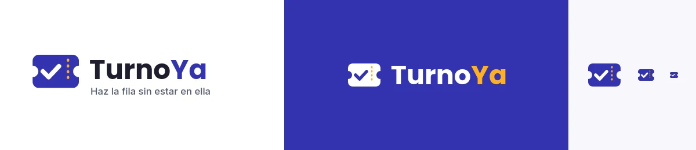

**Haz la fila sin estar en ella.**

---

## 1. Punto de partida

TurnoYa es una plataforma para pedir un **turno virtual** y no tener que esperar en una fila física. La usan universidades, clínicas, laboratorios y oficinas de atención al ciudadano.

De ahí salen tres ideas que guían todas las decisiones visuales:

| Idea | Qué significa para el diseño |
|---|---|
| **Público muy amplio** | Estudiantes, adultos mayores, pacientes y personas con baja visión. La interfaz tiene que ser **legible y accesible** primero. |
| **Uso rápido** | El usuario entra, pide su turno, lo revisa y se va. Es el principio de **"la forma sigue a la función"** (como GOV.UK, no como una revista). |
| **Momento de espera** | Esperar genera ansiedad. El diseño debe transmitir **calma, orden y confianza**. |

Antes de la actividad 2, el sitio usaba una sola fuente (Poppins) para todo, un azul sin paleta definida, ningún logo (solo un ícono genérico de Material Icons) y ningún slogan. Además tenía textos grises que no cumplían el contraste mínimo de WCAG.

---

## 2. Selección de tipografía

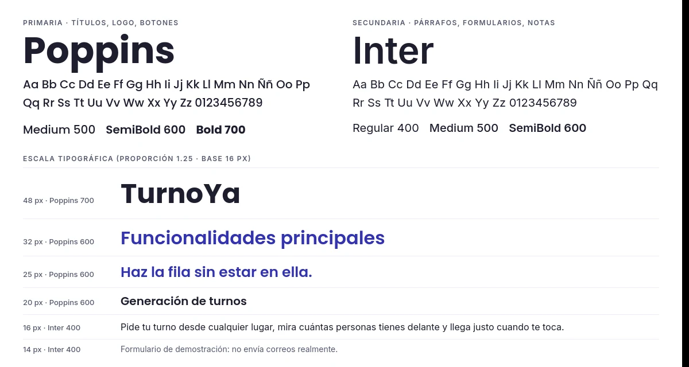

### 2.1 Opciones evaluadas (en Google Fonts)

| Fuente | Tipo | Legibilidad en pantalla | Personalidad | Decisión |
|---|---|---|---|---|
| **Poppins** | Sans serif geométrica | Buena en tamaños grandes; las letras redondas cansan en párrafos largos | Moderna, amable, cercana |  **Primaria** (títulos) |
| **Inter** | Sans serif neo-grotesca | Excelente: diseñada para pantallas, x-height alta, letras bien diferenciadas | Neutral, clara, profesional |  **Secundaria** (texto) |
| Roboto | Sans serif | Muy buena | Neutral, pero es la fuente por defecto de Materialize/Android y no da identidad | Descartada buscamos algo diferente|
| Merriweather | Serif | Buena para lectura larga | Literaria, editorial |  Descartada: TurnoYa no es para leer mucho tiempo |
| Pacifico / Lobster | Escritura / decorativa | Baja | Informal | Descartada: poco legible para un servicio |

### 2.2 Elección final y justificación

**Primaria: Poppins (500, 600, 700).** Se usa en el logo, los títulos, los botones, el menú y los códigos de turno.
- Sus formas geométricas y redondeadas transmiten un servicio moderno y amable, sin la frialdad de un sistema institucional.
- El peso 700 hace que los títulos y el código del turno (**A012**) se distingan de inmediato.

**Secundaria: Inter (400, 500, 600).** Se usa en párrafos, formularios, notas y fechas.
- Está diseñada para leerse en pantalla. Su altura de x alta mantiene la legibilidad a 14–16 px, incluso en el celular.
- Diferencia claramente caracteres que se confunden, como `I l 1` y `O 0`. Eso importa en un sistema donde la gente lee códigos de turno.

**Por qué las dos son sans serif.** Como vimos en clase, para niños, adultos mayores y personas con baja visión o dislexia, la sans serif *"es más fácil para escanear, leer e interactuar"*. TurnoYa atiende justamente a ese público. También seguimos la Ley de Jakob: los usuarios esperan una sans serif limpia en una app de servicios.

**Por qué dos fuentes y no una.** El contraste entre una fuente con personalidad (Poppins) y una neutra (Inter) ayuda a separar la jerarquía: los títulos se ven como títulos y el texto se lee sin esfuerzo. Además, las dos comparten proporciones geométricas, así que combinan bien.

### 2.3 Escala tipográfica

Usamos una escala con **proporción 1.25 (tercera mayor)** sobre una base de 16 px y un interlineado de 1.6 en los párrafos. Así todas las páginas tienen la misma jerarquía:

| Nivel | Tamaño | Fuente | Uso |
|---|---|---|---|
| `--texto-2xl` | 48 px (3 rem) | Poppins 700 | Título del hero |
| `--texto-xl` | 32 px (2 rem) | Poppins 600 | Títulos de sección |
| `--texto-lg` | 25 px | Poppins 600 | Slogan, código del turno actual |
| `--texto-md` | 20 px | Poppins 600 | Títulos de tarjetas |
| `--texto-base` | 16 px | Inter 400 | Párrafos |
| `--texto-sm` | 14 px | Inter 400 | Notas, fechas, chips |

---

## 3. Paleta de colores

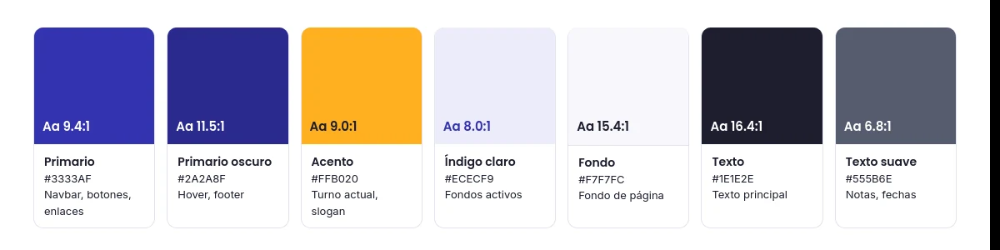

 **Paleta en Coolors:** <https://coolors.co/3333af-2a2a8f-ffb020-ececf9-f7f7fc-1e1e2e-555b6e>

### 3.1 Estrategia: un solo color de marca + acento complementario

Seguimos el consejo de la clase de ceñirse a un solo color de marca, como hacen Facebook, Airbnb o Spotify:

- **Índigo `#3333AF`** es el color de marca y el de todos los elementos interactivos (botones, enlaces, menú). Así el usuario aprende rápido qué se puede pulsar, lo que ayuda a la *capacidad de descubrimiento* y baja la carga cognitiva.
- A partir del índigo armamos una escala monocromática (oscuro `#2A2A8F`, claro `#ECECF9`, fondo `#F7F7FC`) para fondos y estados.
- **Ámbar `#FFB020`** es el complementario del índigo (está al frente en la rueda de color). Lo usamos poco y solo para lo que debe destacar: el turno actual, el slogan, la parte "Ya" del logo y los **elementos de énfasis** (subrayado de títulos y barras laterales de las tarjetas importantes).

### 3.2 Emociones que queremos transmitir

| Color | Emoción / asociación | Por qué sirve en TurnoYa |
|---|---|---|
| **Índigo / azul** | Confianza, calma, seriedad, tecnología | Baja la ansiedad de la espera y da credibilidad institucional (universidades, clínicas). |
| **Ámbar** | Atención, energía, optimismo, "es tu momento" | Llama la atención sobre el turno sin parecer un error (el rojo transmitiría alarma). Además, el ámbar se asocia a "prepárate", como en un semáforo. |
| **Neutros fríos** | Orden, limpieza | Dejan que el contenido y los colores de marca sobresalgan. |

### 3.3 Dónde se usa cada color

Separamos los roles: el **índigo es para interactuar** (lo que se pulsa) y el **ámbar es para resaltar** (lo que se debe mirar). Así el usuario nunca confunde un adorno con un botón.

| Color | Se usa en |
|---|---|
| **Índigo** `#3333AF` | Navbar, botones, enlaces, íconos, títulos de sección, chip de filtro activo |
| **Índigo oscuro** `#2A2A8F` | Hover de botones, footer |
| **Ámbar** `#FFB020` | Tarjeta "Turno actual", slogan, "Ya" del logo, **subrayado de los títulos de sección**, **barras laterales** de Misión/Visión, Objetivo general, objetivo abierto, Progreso general, avances "En proceso" y tarjetas de Contacto, **barra de progreso** |
| **Índigo claro / fondo** | Fondo de la página, fondos de elementos activos |

El ámbar se repite con **el mismo recurso visual en todas las páginas** (una barra de 6 px a la izquierda o un subrayado de 4 px). Esa repetición crea **consistencia**: el usuario aprende que "barra ámbar = contenido destacado". El ámbar como adorno no necesita contraste de texto porque nunca lleva texto encima. Su contraste con el fondo da a propósito la sensación de un detalle cálido sobre una base fría.

---

## 4. Logo y slogan

### 4.1 Logo

- **Símbolo:** un ticket de turno con muescas laterales (el "papelito" de la fila de toda la vida) y un check adentro (turno confirmado). La línea punteada ámbar es el corte del ticket.
- **Logotipo:** "Turno**Ya**" en Poppins 700. La palabra **"Ya"** va en el color de acento para reforzar la idea de inmediatez.
- **Variantes** (en `proyecto_integrador/img/`), todas en formato **WebP**:

| Archivo | Tamaño | Peso | Uso |
|---|---|---|---|
| `logo.webp` | 826 × 187 px | 14 KB | Logo completo con slogan, fondo transparente, para fondos claros (documentos, presentaciones) |
| `logo-icono.webp` | 128 × 128 px | 1.2 KB | Símbolo índigo: **favicon** y menú del celular |
| `logo-icono-claro.webp` | 128 × 128 px | 1.1 KB | Símbolo blanco, para la navbar y el footer (fondos índigo) |

- **Por qué WebP:** es el formato que trabajamos en clase y el que ya usaba el sitio (banner y fotos del equipo). Pesa mucho menos que PNG o JPG con la misma calidad y **conserva la transparencia**, así que el logo se puede poner sobre cualquier fondo. Todas las imágenes del proyecto están en WebP, incluidas las capturas de este informe.
- Los íconos se exportaron a **128 px aunque se muestran a 40 px**, para que se vean nítidos en pantallas de alta densidad (celulares y portátiles con pantalla "retina").

### 4.2 Slogan

## Haz la fila sin estar en ella.

- Resume la propuesta de valor en una frase: la fila existe y se respeta el orden, pero tú no tienes que estar ahí parado.
- Es corto, se dice en un respiro y tiene un pequeño juego de palabras que ayuda a recordarlo.
- Aparece en el hero del inicio (en ámbar, con jerarquía justo debajo del nombre), en el footer de todas las páginas, en el título de la pestaña del inicio y en la meta descripción.

---

## 5. Aplicación al sitio: antes y después

### Inicio

| Antes | Después |
|---|---|
| 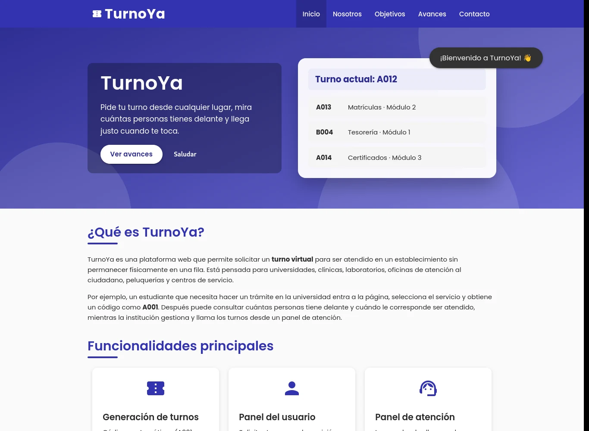 | 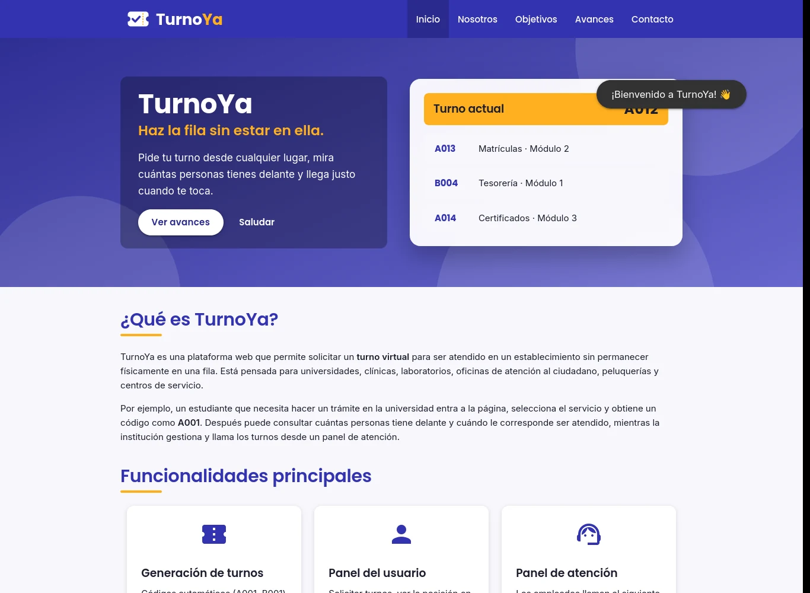 |

- Logo propio en la navbar en vez del ícono genérico de Material Icons.
- El slogan aparece en ámbar debajo del título, como segundo nivel de jerarquía.
- La tarjeta **"Turno actual"** usa el acento ámbar y el código va más grande: es lo más importante de la app y ahora es lo primero que se ve.
- Los códigos de turno (A013, B004…) van en índigo con Poppins, separados de la descripción en Inter.
- Los párrafos usan Inter: se leen más ligeros y caben más palabras por línea sin perder legibilidad.

### Nosotros

| Antes | Después |
|---|---|
| 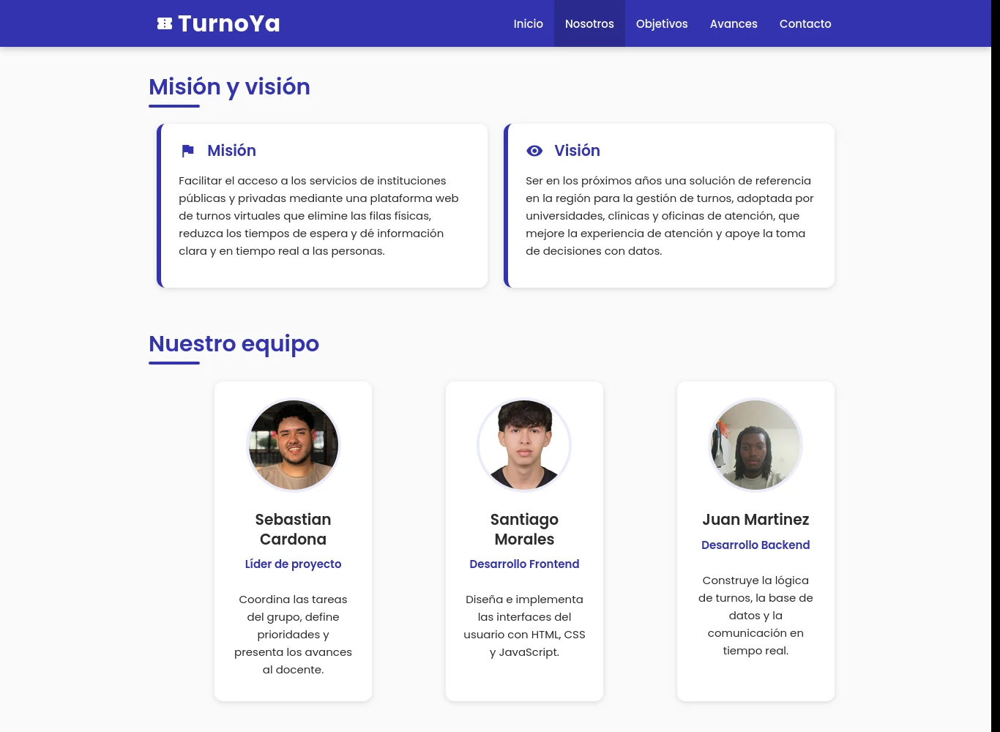 | 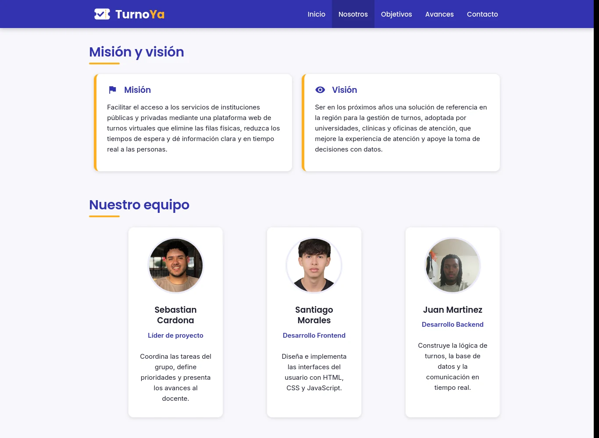 |

- Las barras laterales de **Misión** y **Visión** pasaron de índigo a **ámbar**, el mismo color de la tarjeta "Turno actual".
- El subrayado de los títulos ("Misión y visión", "Nuestro equipo") también es **ámbar**. El título queda en índigo, así que se distingue mejor del texto.

### Objetivos

| Antes | Después |
|---|---|
| 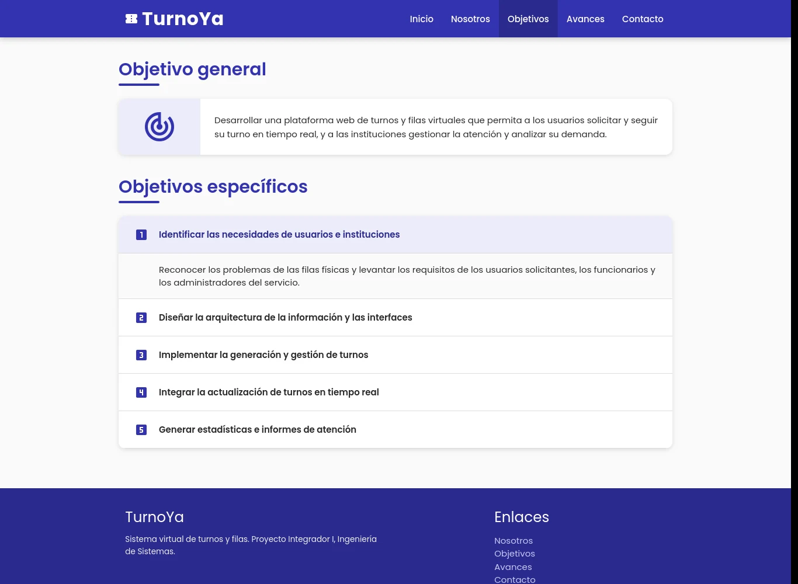 | 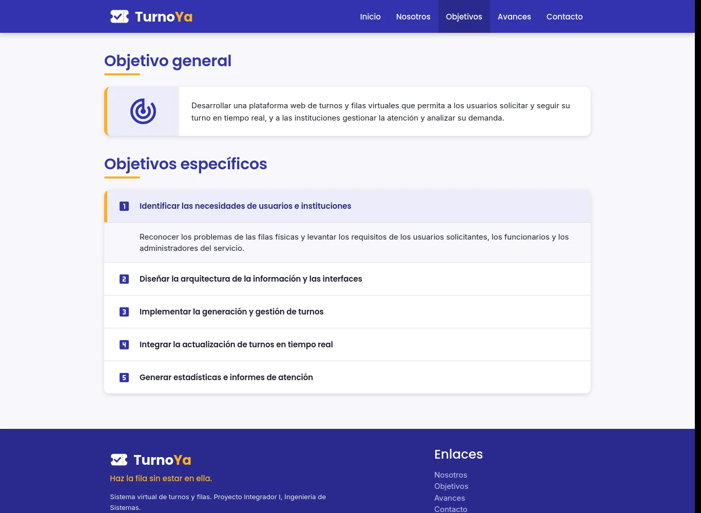 |

- El subrayado de **"Objetivo general"** y **"Objetivos específicos"** pasó a ámbar.
- La tarjeta del objetivo general tiene una **barra lateral ámbar**, como Misión y Visión.
- El objetivo específico que está **abierto** muestra la misma barra ámbar, que indica cuál se está leyendo.

### Avances

| Antes | Después |
|---|---|
| 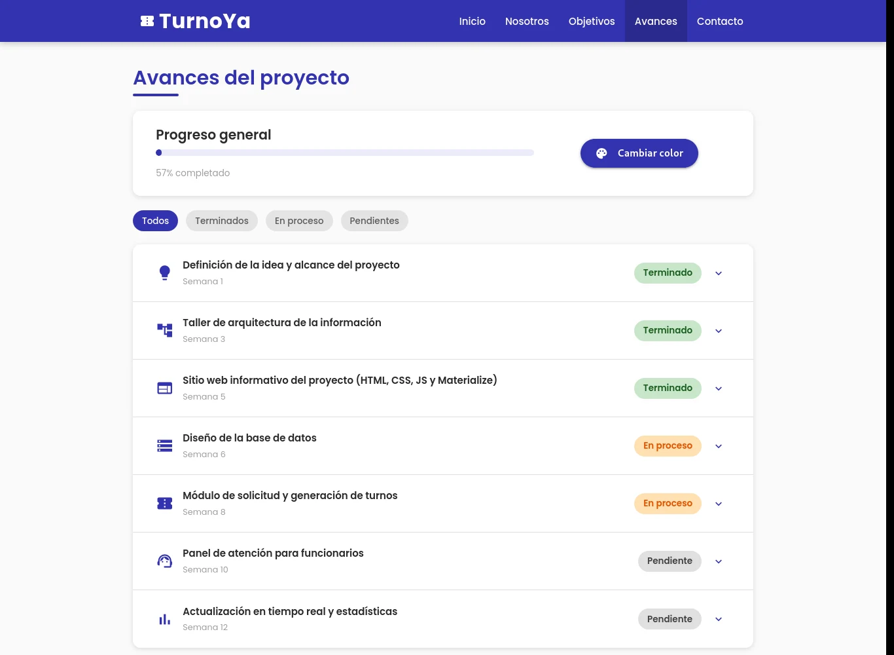 | 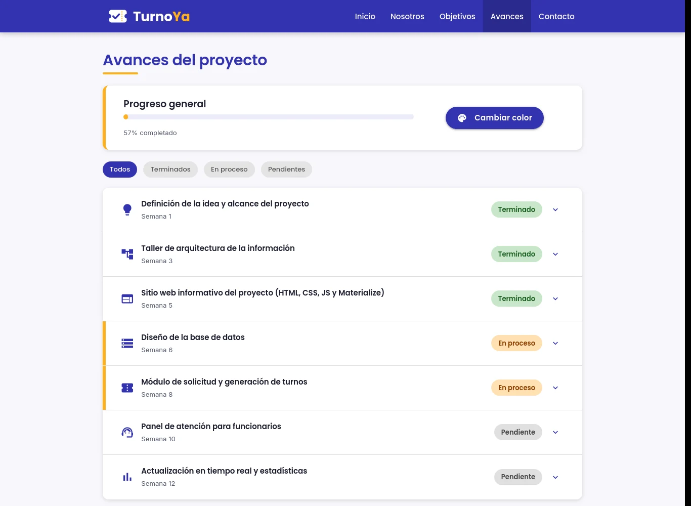 |

- La tarjeta **"Progreso general"** tiene barra lateral ámbar y la **barra de progreso** se llena en ámbar. En la captura aparece casi vacía porque se anima al cargar la página; en el navegador llega al 57 %.
- Los avances **"En proceso"** llevan una barra ámbar a la izquierda, así se ve de un vistazo en qué está trabajando el equipo.
- El subrayado del título pasó a ámbar.
- El chip **"En proceso"** pasó de naranja `#E65100` (2.99:1, no cumplía) a marrón `#8A3C00` (6.1:1).
- Las fechas ("Semana 1", "Semana 3"…) pasaron del gris de Materialize (2.68:1) al texto suave de la paleta (6.3:1).
- El botón **"Cambiar color"** ahora solo alterna entre tonos de la paleta.

### Contacto

| Antes | Después |
|---|---|
| 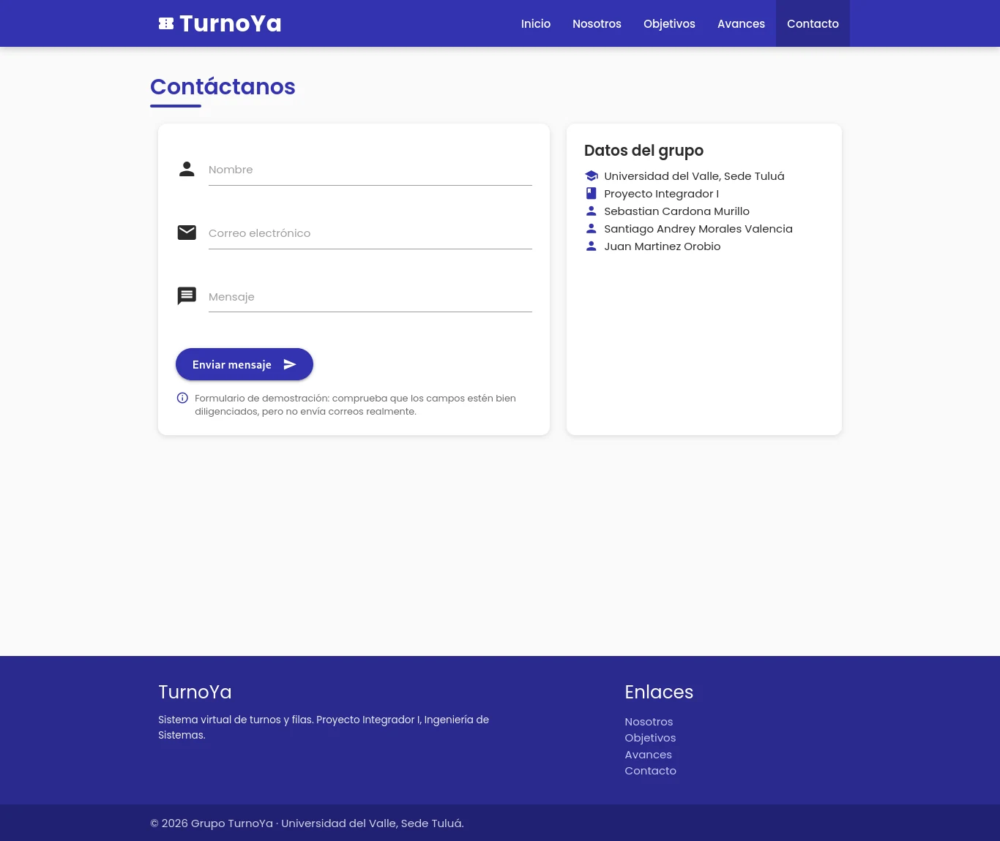 | 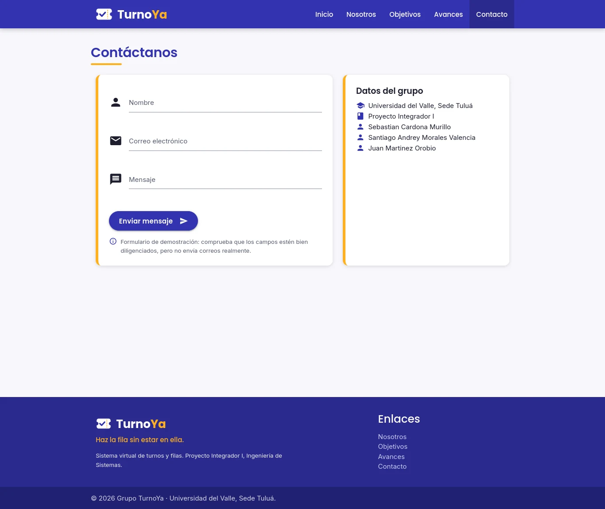 |

- El **formulario** y la tarjeta **"Datos del grupo"** tienen barra lateral ámbar, el mismo recurso de las otras páginas.
- El subrayado de "Contáctanos" pasó a ámbar.
- Las etiquetas de los campos (Nombre, Correo, Mensaje) tenían el gris de Materialize (2.68:1). Ahora usan `#555B6E`.
- El footer muestra el logo y el slogan.

### Celular

| Antes | Después |
|---|---|
| 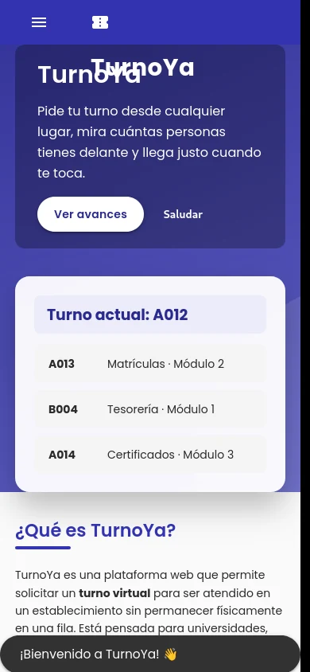 | 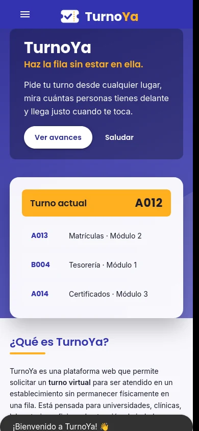 |

---

## 6. Resumen de cambios en el código

| Archivo | Cambio |
|---|---|
| `css/style.css` | Variables de diseño (paleta, dos fuentes, escala tipográfica); Poppins para títulos e Inter para texto; estilos del logo, slogan, acento, foco visible y correcciones de contraste; subrayado de títulos y barras laterales en ámbar |
| Las 5 páginas `.html` | Carga de Poppins + Inter, favicon WebP, meta descripción, logo en navbar, menú móvil y footer, slogan en el footer |
| `index.html` | Slogan en el hero; tarjeta "Turno actual" con el acento |
| `contacto.html` | Ícono de éxito con color de la paleta; etiquetas `
` cerradas |
| `avances.html` | Clase `card-progreso` para la barra ámbar de "Progreso general" |
| `js/main.js` | El botón "Cambiar color" solo usa tonos de la paleta |
| `img/logo.webp`, `img/logo-icono.webp`, `img/logo-icono-claro.webp` | Logo nuevo en WebP (completo, símbolo y versión clara) |
| `docs/capturas/*.webp` | Capturas de antes y después, muestras de tipografía, paleta y logo, todas en WebP |

Todos los colores y tamaños están en las variables CSS al inicio de `style.css`. Si cambia una decisión de diseño, se cambia en un solo lugar y se aplica a todo el sitio.
